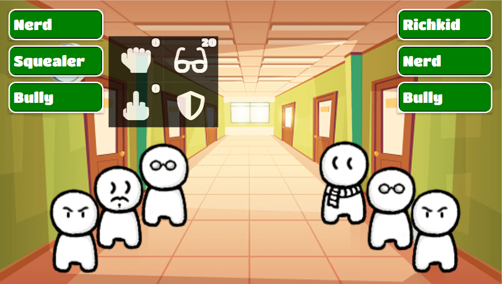

# School Fight

## About

School Fight is a turn based fighting game. Choose your party and battle it out in 3vs3 fights to become king of school!
There are three types of characters: strength, intelligence and assholiness. The mechanics work by a rock paper scissors principle: 
strength is effective against intelligence, intelligence is effective against assholiness and assholiness is effective against strength
All characters (including the opponent party) attack at the same time. This gives the fights a unique dynamic.
Use items to deal damage or replenish your health. New items and stat upgrades can be purchased in the shop in between battles. You earn $1 per character who survived a level. Beat all nine levels including two mini games and a boss battle.

## How to play

Open index.html or go to https://eckeecke.github.io/schoolfight/ to start the game. Choose three characters for your party. Click on a character. Select a type of attack and an opponent to attack. Do this for all your party members. Alternatively set a character on defending to reduce taken damage next turn. To control minigames you need to click on the screen. To use an item simply click one of the icons on the bottom of the screen. The sandwich recovers health for your whole party. The bomb damages all opoonents. The more of your characters survive a fight, the more items you can obtain.



## Used Technologies

The game is written in Javascript using mainly regular HTML and CSS for displaying graphics.

## Code structure and tests

- `js_schoolfight/characters.js`: character templates, attack types and character health/stat behavior.
- `js_schoolfight/combat.js`: damage calculation, type advantages, enemy target selection, attack rotation and complete battle rounds. No DOM, audio or timer dependencies.
- `js_schoolfight/script.js`: game flow, UI, animations, shop and minigames.
- `js_schoolfight/game-flow.js`: active phase, input permissions and guards for delayed phase callbacks.

Scripts load in that order. The game still runs by opening `index.html` directly; no build or installation is required.

`resolveBattleRound` updates the supplied character instances and returns attack/defense events, surviving character counts, the next attack rotation state and an outcome (`continue`, `victory` or `defeat`). Enemy actions resolve first; queued player actions still execute even if their attacker falls during that round. Losing all players takes priority in a double knockout. The UI presents these results and handles animations and level transitions separately.

`GameFlow` owns the current phase. Input handlers use `can(action)` instead of separate animation/dialogue lock flags. Phase-dependent timers use `after(callback, delay)`; their callbacks expire when the phase changes, including when the game later returns to the same phase. Cosmetic animation cleanup can use ordinary timers.

Run the core rule tests with Node.js 18 or later:

```sh
node --test tests/*.test.cjs
```
